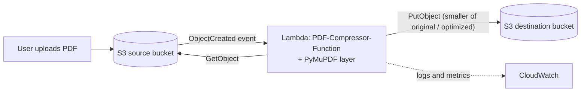

# Serverless PDF Compression Pipeline on AWS (S3 + Lambda + PyMuPDF)

An event-driven, serverless workflow that automatically optimizes PDF files. Upload a PDF to a **source S3 bucket** and an **S3 event** triggers an **AWS Lambda** function that downloads the file, optimizes it with **PyMuPDF**, compares file sizes, and writes the smaller result (or the original, if optimization made it larger) to a separate **destination S3 bucket**. There are no servers to manage and you pay only when files are processed.


> **Project origin:** built as part of a cloud internship, following an instructor-provided implementation guide. The Lambda function code (`lambda_function.py`) and the PyMuPDF Lambda layer ZIP were supplied by the instructor as a matching pair. The infrastructure, IAM permissions, configuration, trigger wiring and testing described here were set up and verified by hand in the AWS console.

---

## Table of Contents

1. [Purpose and Value](#purpose-and-value)
2. [How It Works](#how-it-works)
3. [AWS Resources](#aws-resources)
4. [Configuration Reference](#configuration-reference)
5. [Setup Guide](#setup-guide)
6. [IAM Policy (Least Privilege)](#iam-policy-least-privilege)
7. [Testing the Pipeline](#testing-the-pipeline)
8. [Troubleshooting](#troubleshooting)
9. [Security and Safety Notes](#security-and-safety-notes)
10. [Limitations](#limitations)
11. [Possible Improvements](#possible-improvements)
12. [Cost Notes](#cost-notes)
13. [Skills Demonstrated](#skills-demonstrated)
14. [Author](#author)

---

## Purpose and Value

Large PDFs slow down uploads, downloads, email attachments and storage. Compressing them manually does not scale. This project automates it:

- **Zero manual steps.** Drop a file in a bucket; the compressed version appears in another.
- **Serverless and pay-per-use.** No EC2 instance to run or patch.
- **Safe by design.** If optimization would make a file *larger*, the original is kept instead.
- **Reusable pattern.** The same S3 → Lambda → S3 pattern applies to image resizing, video thumbnails, document conversion, virus scanning and data ingestion.

## How It Works

1. A user uploads a PDF to the **source bucket**.
2. S3 emits an **`ObjectCreated`** event that invokes the Lambda function `PDF-Compressor-Function`.
3. Lambda downloads the PDF from the source bucket.
4. It attempts **structural optimization** with **PyMuPDF** (imported as `pymupdf` or as the `fitz` alias, depending on the supplied code).
5. It **compares the original and optimized sizes**.
6. It uploads the **smaller** file (or the original if the optimized one is larger) to the **destination bucket** under the **same key/name**.
7. Execution logs and metrics (invocations, errors, duration, throttles) go to **Amazon CloudWatch**.



## AWS Resources

| Resource | Example name | Purpose |
|---|---|---|
| Source S3 bucket | `student-pdf-source-unique` | Receives original PDFs and triggers Lambda |
| Destination S3 bucket | `student-pdf-output-unique` | Stores optimized PDFs |
| Lambda function | `PDF-Compressor-Function` | Runs the compression code |
| Lambda layer | `pymupdf-layer` | Provides the PyMuPDF dependency |
| IAM execution role | `pdf-compressor-lambda-role` | Allows logging and the required S3 actions |
| IAM inline policy | `PDFCompressionS3Access` | Read from source, write to destination |
| CloudWatch Logs | (automatic) | Invocation logs for debugging |

Bucket names must be **globally unique**. Keep the buckets, function and layer in the **same Region** (`us-east-1` in this lab).

## Configuration Reference

| Setting | Value | Notes |
|---|---|---|
| Runtime | Python (3.14 in the guide) | Must match the runtime the layer was built for |
| Architecture | `x86_64` | Must match the supplied layer |
| Memory | 1,024 MB | For small-file testing. Increase only after testing larger files |
| Timeout | 120 seconds | Increase for larger PDFs |
| Ephemeral storage | 1,024 MB | Temporary storage for the downloaded and processed file |
| Env var `DESTINATION_BUCKET` | exact destination bucket name | Where results are written |
| Env var `MAX_FILE_MB` | `50` | Maximum file size setting used by the function |
| Trigger | S3, source bucket, *All object create events* | Source bucket only |

## Setup Guide

### Prerequisites

- An AWS account with permission to use S3, IAM and Lambda.
- The supplied **`lambda_function.py`** and **PyMuPDF layer ZIP** (use them as a matching pair; do not mix versions).
- Region chosen (this guide uses `us-east-1`).

### 1. Create the S3 buckets

1. Create the **source** bucket (for example `student-pdf-source-2026-unique`).
2. Create the **destination** bucket (for example `student-pdf-output-2026-unique`) in the **same Region**.
3. Keep **Block all public access** enabled on both. Note both exact names.

### 2. Create the Lambda execution role

1. IAM, *Roles, Create role*, trusted entity **AWS service**, use case **Lambda**.
2. Attach **`AWSLambdaBasicExecutionRole`** (CloudWatch Logs).
3. Name it `pdf-compressor-lambda-role`.
4. Add an **inline policy** named `PDFCompressionS3Access` using the [policy below](#iam-policy-least-privilege), with your real bucket names.

### 3. Create the Lambda function

1. Lambda, *Create function, Author from scratch*, name `PDF-Compressor-Function`.
2. Choose the runtime and `x86_64` architecture that match the supplied layer.
3. Use the existing role `pdf-compressor-lambda-role`. (If the console doesn't offer it, create with the default role and attach the S3 policy to the role actually used.)

### 4. Create and attach the PyMuPDF layer

1. Lambda, *Layers, Create layer*, name `pymupdf-layer`.
2. If the ZIP exceeds the console's direct-upload limit, upload it to a **private S3 bucket in the same Region** and choose *Create from a file in Amazon S3*.
3. Select `x86_64` and the matching Python runtime, then create the layer.
4. Open the function, *Layers, Add a layer, Custom layers*, choose `pymupdf-layer` and its version. **Creating a layer does not attach it automatically.**

The layer ZIP must have a **top-level `python/` directory** containing the PyMuPDF package. Lambda enforces a combined **250 MiB uncompressed** limit across the function and its layers.

### 5. Configure the function

1. *Configuration, General configuration*: Memory **1,024 MB**, Timeout **120 s**, Ephemeral storage **1,024 MB**.
2. *Configuration, Environment variables*: add `DESTINATION_BUCKET` and `MAX_FILE_MB=50`.

### 6. Deploy the code

1. Open the *Code* tab, replace the contents of `lambda_function.py` with the supplied code, and click **Deploy**.
2. Make sure the import in the code matches the layer: `import pymupdf` or `import pymupdf as fitz`.

### 7. Add the S3 trigger

1. *Add trigger, S3*, choose the **source** bucket, event type **All object create events**.
2. Acknowledge the recursive-invocation warning and add the trigger.

> **Important:** attach the trigger to the **source bucket only**. If the destination bucket also triggers this function, every output file would invoke Lambda again, creating a loop and unexpected charges. Keeping the two buckets separate is what prevents this.

## IAM Policy (Least Privilege)

Replace the placeholders with your bucket names. The function only needs to read from the source and write to the destination.

```json
{
  "Version": "2012-10-17",
  "Statement": [
    {
      "Sid": "ReadSourcePDFs",
      "Effect": "Allow",
      "Action": ["s3:GetObject"],
      "Resource": "arn:aws:s3:::YOUR-SOURCE-BUCKET/*"
    },
    {
      "Sid": "WriteCompressedPDFs",
      "Effect": "Allow",
      "Action": ["s3:PutObject"],
      "Resource": "arn:aws:s3:::YOUR-DESTINATION-BUCKET/*"
    }
  ]
}
```

`s3:GetObject` also covers the metadata (`HeadObject`) request, since IAM has no separate `s3:HeadObject` action. Do not use `AmazonS3FullAccess` or `AdministratorAccess` for this role.

## Testing the Pipeline

1. Upload a **small test PDF (under 5 MB)** to the source bucket.
2. Open *Lambda, Monitor, View CloudWatch logs* and check the latest invocation for errors.
3. Open the destination bucket and confirm a PDF with the **same key/name** appears.
4. Download it and check it opens correctly: text, images, links, forms and signatures, as relevant.
5. Compare file sizes. If optimization made the file larger, the original should have been kept.

Optional command-line check of sizes:

```bash
aws s3api head-object --bucket YOUR-SOURCE-BUCKET      --key sample.pdf --query ContentLength
aws s3api head-object --bucket YOUR-DESTINATION-BUCKET --key sample.pdf --query ContentLength
```

## Troubleshooting

| Error / symptom | What to check |
|---|---|
| `No module named 'fitz'` or `'pymupdf'` | Layer attached to the function? ZIP has a top-level `python/` folder? Import name matches the package? Runtime and architecture match the layer? |
| `403 Forbidden` on `HeadObject` | The role actually attached to the function needs `s3:GetObject` on `arn:aws:s3:::SOURCE-BUCKET/*`. Also check bucket policies, permissions boundaries and KMS policies |
| `AccessDenied` on `PutObject` | Role needs `s3:PutObject` on `arn:aws:s3:::DESTINATION-BUCKET/*`. Check destination bucket policy and encryption requirements |
| Function times out | Test a smaller PDF. Increase timeout, memory or ephemeral storage based on observed need |
| Output file missing | Check the latest CloudWatch logs, the `DESTINATION_BUCKET` value, and that the trigger is on the **source** bucket |
| Layer rejected (size or import errors) | Verify the supplied ZIP and the 250 MiB combined limit instead of re-uploading the same file |

## Security and Safety Notes

- Both buckets keep **Block all public access** enabled.
- The IAM role follows **least privilege**: read on one bucket, write on another, plus CloudWatch logging.
- Separate source and destination buckets, with the trigger on the source only, avoid recursive invocation.
- Use only the instructor-supplied layer. Do not use random third-party layers, which run inside your function with its permissions.

## Limitations

- **Structural optimization only.** PyMuPDF optimization typically gives modest savings on PDFs that are already well compressed, and some files may not shrink at all (the original is then kept).
- **Resource limits.** The lab settings (1,024 MB memory, 120 s timeout, 1,024 MB ephemeral storage, `MAX_FILE_MB=50`) are for small to medium files. Very large PDFs need more resources and a higher size cap.
- **No notification.** There is no alert when processing fails. Failures are only visible in CloudWatch logs.
- **Same-name output.** The result uses the same key as the input, so uploading a file with an existing name overwrites the earlier output.
- **Trigger scope.** The trigger fires on *all* object-create events, so non-PDF uploads will also invoke the function.
- **Dependency pairing.** The function code, runtime, architecture and layer must match exactly.

## Possible Improvements

- Add an S3 trigger **suffix filter (`.pdf`)** and optionally a prefix, so only PDFs invoke Lambda.
- Add a **dead-letter queue** or on-failure destination (SQS/SNS) and **CloudWatch alarms** on `Errors` and `Throttles`.
- Send an **SNS email/Slack notification** with original vs. compressed size.
- Add **image downsampling** for much larger savings on image-heavy PDFs.
- Handle **large files** with higher memory/ephemeral storage or a container-based Lambda.
- Record compression stats (size before/after, duration) in **DynamoDB** and expose them via **API Gateway**.
- Serve compressed PDFs through **CloudFront** and add a small web front end (shown as optional in the architecture).
- Add S3 **lifecycle rules** and **SSE-KMS** encryption on both buckets.
- Define the stack as code (**AWS SAM, CloudFormation or Terraform**).

## Cost Notes

- Lambda is billed per invocation and per GB-second of runtime; S3 per storage and requests; CloudWatch per log ingestion and storage. For a lab with a handful of small PDFs the cost is minimal.
- Avoid recursive triggers (see setup step 7), which are the most common cause of runaway Lambda bills.
- Clean up test buckets, the Lambda function and its log group when finished.

## Skills Demonstrated

- Serverless, event-driven architecture on AWS (S3 events to Lambda)
- IAM roles and least-privilege inline policies
- Lambda configuration: layers, runtime and architecture matching, memory, timeout, ephemeral storage, environment variables
- Python-based document processing with PyMuPDF
- Preventing recursive invocation and designing safe fallbacks
- Debugging with CloudWatch Logs and permission-error analysis (`403`, `AccessDenied`)

## Author

**Piyush Bhadange**
[GitHub](https://github.com/bhadangepiyush-droid) | [LinkedIn](https://www.linkedin.com/in/piyush-bhadange-a8a01328b)
